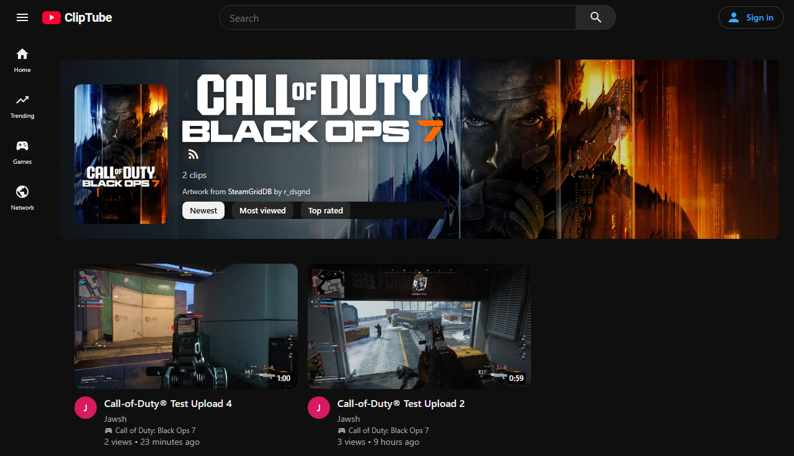
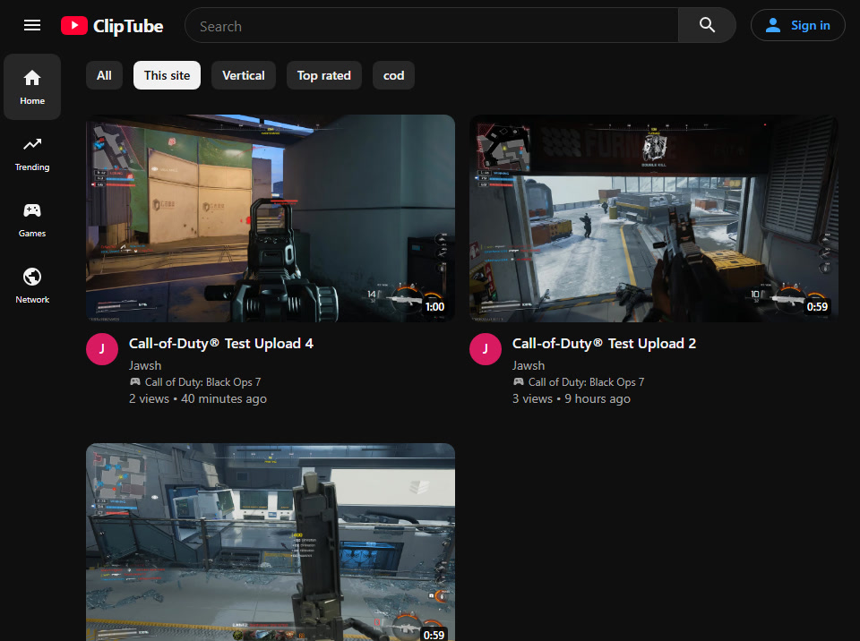
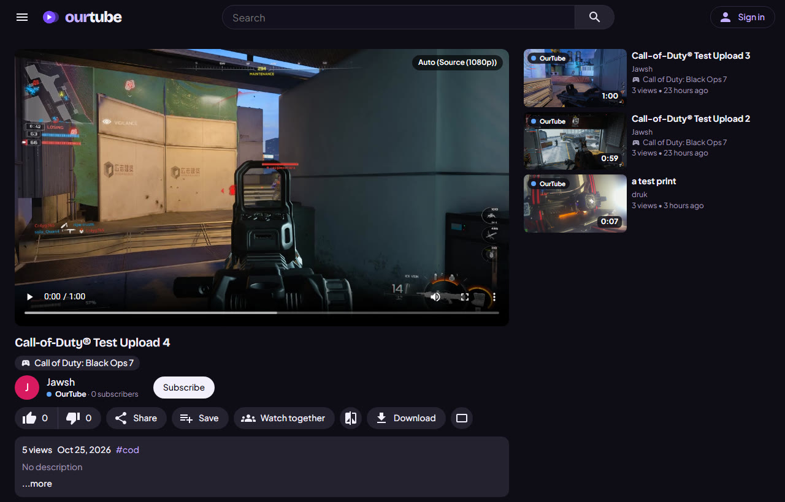
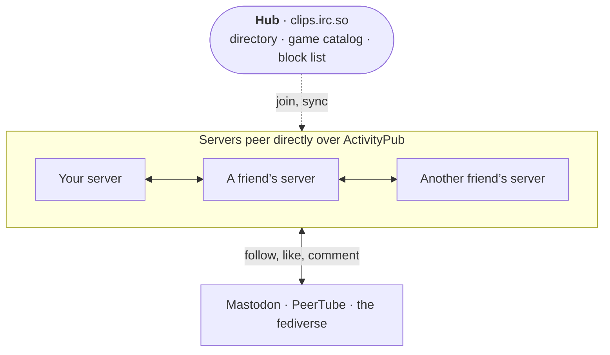

<div align="center">


# ClipTube

**A self-hosted YouTube for gaming clips.**<br>
Upload your best moments, share them with friends, and link your server with theirs.

[](https://nodejs.org)
[](#quick-start)
[](docs/wiki/Fediverse.md)
[](docs/wiki/Configuration.md#the-data-folder)
[](https://react.dev)
[](docs/wiki/Uploading-and-Editing.md#how-uploads-are-processed)

[Features](#features) •
[Quick start](#quick-start) •
[The network](#one-network-many-servers) •
[Wiki](docs/wiki/Home.md) •
[Development](#development)



</div>

## Why ClipTube

Your clips shouldn't live on a platform you don't control. ClipTube is a video site you run yourself, built
around what a clip site needs:

- **Clips go up fast.** Drop in a pile of recordings, fill in the details while they upload, and publish when
  you're ready. H.264 recordings are remuxed losslessly in seconds; anything else is transcoded, on your GPU if
  you have one.
- **Every friend runs their own.** Each person hosts their own clips. The servers link up into one network, so
  everyone's clips show up in everyone's feed, and likes, comments and subscriptions work across servers.
- **It speaks the fediverse.** Channels can be followed from Mastodon and PeerTube, and ClipTube follows
  PeerTube channels back.
- **It's yours.** One container, one SQLite database, one folder to back up. No ads, and analytics that count
  views without recording who watched.

<table>
  <tr>
    <td width="50%"></td>
    <td width="50%"></td>
  </tr>
  <tr>
    <td align="center"><sub>Home: clips from this server and the rest of the network</sub></td>
    <td align="center"><sub>Watch: adaptive quality, likes, sharing, compare and download</sub></td>
  </tr>
</table>

## Features

<table>
<tr>
<td width="50%" valign="top">

### Upload and edit

- Drag in many files at once, with progress bars
- Uploads stay **drafts** until you click *Save details*
- Lossless remux for H.264, transcoding for MKV, HEVC, WebM and the rest, with NVENC, Quick Sync or AMF
- **Timeline editor**: trim, split, cut, volume, fades, frame-picked thumbnails; non-destructive, so the
  original is one click away
- Captions (WebVTT, SRT), skippable sponsor and intro parts

</td>
<td width="50%" valign="top">

### Watch

- Adaptive streaming (HLS) that always offers the full-quality source
- Theater mode, keyboard shortcuts, resume where you left off
- Community titles and thumbnails, visible dislikes, support links
- Link previews with an inline player in Discord and Slack
- Original downloads when the uploader allows them
- **Playlists** and Watch later, mixing clips from any server, with shuffle, loop and autoplay
- **Watch together**: parties that play in sync for everyone, with a queue, chat and reactions
- **Live streaming** from OBS with a live chat, kept as a video afterwards

</td>
</tr>
<tr>
<td width="50%" valign="top">

### Clip tools

- **Clip a moment** from any video into a new one that links back
- GIF and MP4 export of any range
- Looping share links (`/watch/abc?t=12&end=20`)
- **Compare** two clips side by side, frame-aligned, at up to 1/10 speed

</td>
<td width="50%" valign="top">

### Games

- A game catalog with other spellings, so clips match across servers
- A page and a feed for every game
- Covers, title logos and banners from **SteamGridDB**, with the artists credited
- One catalog for the whole network, kept by the hub

</td>
</tr>
<tr>
<td width="50%" valign="top">

### Discover

- Home with *All*, *For you* (it tells you why) and *Vertical*
- Trending, and full-text search with filters
- RSS and Atom for the site, every channel and every game
- Notifications in the app, as web push or by email
- Creator analytics with retention curves

</td>
<td width="50%" valign="top">

### Network and fediverse

- Servers peer directly over **ActivityPub**; the hub is optional
- Likes, comments and subscriptions across servers
- Follow and be followed from Mastodon and PeerTube
- **Link your accounts** on several servers, verified both ways, so they show as one person
- Move a channel to another server, subscribers included

</td>
</tr>
<tr>
<td width="50%" valign="top">

### Moderation

- Members, moderators and admins
- Reports, also about content on other servers, with an audit log
- Spam holds for comments, rate limits, blocked words
- Open, approval, invite-only or closed sign-up; storage quotas
- Copyright notices, counter-notices and strikes

</td>
<td width="50%" valign="top">

### Privacy

- Pause watch history, or browse in anonymous mode
- Download everything you've put on the site
- Delete your account, with a 7-day grace period
- Analytics keep counts only, never who watched

</td>
</tr>
</table>

## Quick start

You need **Docker** with Compose. To share beyond your own network you also need a domain name and a reverse
proxy with HTTPS in front (Nginx Proxy Manager, Caddy, nginx or a tunnel).

```bash
git clone https://github.com/JawshTheDark/cliptube.git
cd cliptube
mkdir -p data
docker network create proxy-net    # the network your reverse proxy shares with ClipTube (once)
docker compose up -d --build
docker logs cliptube               # shows the one-time setup code
```

Then:

1. Point your reverse proxy at **`cliptube:3000`**, and let it pass large uploads (the
   [Installation](docs/wiki/Installation.md) guide has settings for Nginx Proxy Manager, Caddy and nginx).
2. Open the site and **create the first account**. It becomes the admin; the form asks for the setup code
   from the log, so nobody else can claim a fresh server.
3. In **Admin → Overview**, set the **Public URL** to your `https://` address and choose who may sign up.
4. Optional: **Admin → Network → Join network** with `https://clips.irc.so` to link up with the ClipTube
   network, and add a SteamGridDB key under **Admin → Games** for game artwork.

No reverse proxy yet, or no Docker? The [Installation](docs/wiki/Installation.md) guide covers a standalone
container, running straight from Node.js, hosting at home and GPU encoding.

## One network, many servers



- **Everyone hosts their own clips.** Video files are never copied: viewers stream from the server that has
  the clip, while titles, likes, comments and subscriptions travel between servers as ActivityPub activities.
- **The hub is the front door, not a single point of failure.** It keeps the list of servers, the shared game
  catalog with its artwork, and a block list every member follows. It can lock the network down or require
  approval. Servers also peer with each other directly, so if the hub goes away the rest keep working.
- **Each server stays in charge of itself.** Decide who may peer with you, block any server, keep a clip off
  the network, or leave at any time.

Details: [Network](docs/wiki/Network.md), [Fediverse](docs/wiki/Fediverse.md), and the protocol in
[docs/federation.md](docs/federation.md).

## Under the hood

| Part | Built with |
| --- | --- |
| Server | Node.js 22.13+ (24 in the Docker image), Express 5, the built-in `node:sqlite` |
| Web app | React 19, React Router, Vite, hls.js |
| Media | FFmpeg and FFprobe bundled through npm, optional hardware encoders |
| Background work | A persistent job queue with separate lanes for media, network and transfers |
| Federation | ActivityPub with HTTP Signatures, WebFinger, NodeInfo |
| Storage | One SQLite file plus a data folder; migrations back up the database before they run |

## Configuration

Almost everything is set in the **Admin** pages: site name, Public URL, sign-up, upload and storage limits,
maximum resolution, encoder, adaptive streaming, email, game artwork and the network. A few things are set in
the environment:

| Variable | Default | What it does |
| --- | --- | --- |
| `PORT` | `3000` | Port to listen on |
| `HOST` | `0.0.0.0` | Interface to bind |
| `DATA_DIR` | `./data` (`/data` in Docker) | Database, videos, thumbnails and backups |
| `TRUST_PROXY` | unset (`1` in Docker) | Trust `X-Forwarded-*` headers from a reverse proxy |
| `SETUP_CODE` | random | The code needed to create the first (admin) account |
| `FFMPEG_PATH`, `FFPROBE_PATH` | bundled | Use another FFmpeg, for example one built for your GPU |

All settings, the data folder and what to back up: [Configuration](docs/wiki/Configuration.md).

## Command line

Server operators can manage the network, accounts and settings without a web login:

```bash
docker exec cliptube node server/cli.js network status
docker exec cliptube node server/cli.js network join https://clips.irc.so
docker exec cliptube node server/cli.js user role alice moderator
docker exec -i cliptube node server/cli.js settings set-secret steamgriddb_api_key < keyfile
```

Every command: [Admin CLI](docs/wiki/Admin-CLI.md).

## Updating

```bash
git pull && docker compose up -d --build
```

Or deploy from another machine over SSH. The script backs up the database, keeps the old image for rollback,
rebuilds and waits for the health check:

```bash
scripts/deploy.sh user@your-server
```

Backups, rollbacks and moving to a new server: [Upgrading and Backups](docs/wiki/Upgrading-and-Backups.md).

## Development

```bash
npm install
npm run dev     # API on :3000, web app with hot reload on :5173
npm test        # unit tests plus real multi-server federation tests (about a minute)
```

Database changes go in `server/migrations.js` as a new numbered migration. The repository layout, the test
setup and the fediverse interop sandbox are described in [Development](docs/wiki/Development.md).

## Documentation

| Page | What's in it |
| --- | --- |
| [Installation](docs/wiki/Installation.md) | Docker, reverse proxies, Node.js, hosting at home, GPU encoding, first run |
| [Configuration](docs/wiki/Configuration.md) | Environment, admin settings, email, the data folder |
| [Upgrading and Backups](docs/wiki/Upgrading-and-Backups.md) | Updates, rollbacks, backups, moving servers |
| [Uploading and Editing](docs/wiki/Uploading-and-Editing.md) | Uploads, drafts, processing, the timeline editor, captions |
| [Watching and Discovery](docs/wiki/Watching-and-Discovery.md) | The player, streaming, feeds, notifications, search, analytics |
| [Clip Tools and Games](docs/wiki/Clip-Tools-and-Games.md) | Clipping, exports, compare, the game catalog, SteamGridDB |
| [Watch Parties](docs/wiki/Watch-Parties.md) | Watching with friends in sync, the queue, chat and reactions |
| [Live Streaming](docs/wiki/Live-Streaming.md) | Going live from OBS, the live chat, recordings, turning it on |
| [Network](docs/wiki/Network.md) | Hubs, members, peering, blocking, running a hub |
| [Fediverse](docs/wiki/Fediverse.md) | Mastodon, PeerTube, moving a channel |
| [Moderation and Legal](docs/wiki/Moderation-and-Legal.md) | Roles, reports, spam, sign-up, copyright, privacy |
| [Admin CLI](docs/wiki/Admin-CLI.md) | Every command-line command |
| [Troubleshooting](docs/wiki/Troubleshooting.md) | Common problems and their fixes |
| [Development](docs/wiki/Development.md) | Code layout, tests, migrations, releases |
| [Android App](docs/wiki/Android-App.md) | Installing the APK, servers and sign-in, uploading from your phone |
| [Security](SECURITY.md) | Reporting a vulnerability, and how servers and networks are protected |

## Status

ClipTube runs on three linked servers, with [clips.irc.so](https://clips.irc.so) as the hub. Every
milestone in [PLAN.md](PLAN.md) is done (current release: **v1.9.0**); smaller ideas are tracked in
[TODO.md](TODO.md). The Android app is in [mobile/](mobile/README.md), with APKs on the
[releases page](https://github.com/JawshTheDark/cliptube/releases).

## Credits

Game artwork comes from the [SteamGridDB](https://www.steamgriddb.com) community, and each image's artist is
credited on its game page. Video work is done by [FFmpeg](https://ffmpeg.org), adaptive playback by
[hls.js](https://github.com/video-dev/hls.js), and federation follows the vocabulary of
[PeerTube](https://joinpeertube.org) so the two play each other's videos.
