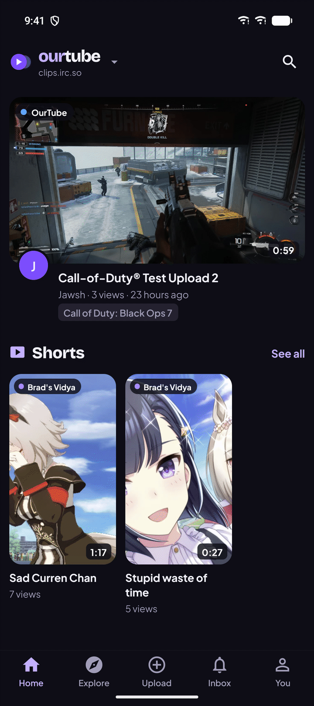

# Android App

OurTube for Android browses, plays and uploads videos, Shorts and live streams on any OurTube server (called
ClipTube before 1.13), with a native player and a sign-in kept for each server you use. It talks to the same API as
the website, so nothing needs setting up on the server beyond running version 1.5 or newer.

<table>
  <tr>
    <td width="25%"></td>
    <td width="25%"></td>
    <td width="25%"></td>
    <td width="25%"></td>
  </tr>
</table>

- [Install](#install)
- [Servers and signing in](#servers-and-signing-in)
- [What you can do](#what-you-can-do)
- [Which server a video is on](#which-server-a-video-is-on)
- [Tablets, turning and density](#tablets-turning-and-density)
- [Admin and moderation](#admin-and-moderation)
- [Shorts](#shorts)
- [Comments and times](#comments-and-times)
- [Playlists and Watch later](#playlists-and-watch-later)
- [Watch parties](#watch-parties)
- [Live streams](#live-streams)
- [Uploading from your phone](#uploading-from-your-phone)
- [Links that open in the app](#links-that-open-in-the-app)
- [Troubleshooting](#troubleshooting)
- [Building and releasing](#building-and-releasing)

## Install

1. On the phone, open the [releases page](https://github.com/JawshTheDark/ourtube/releases) and pick the newest
   **OurTube for Android** release (tags named `android-v…`).
2. Download the `.apk` file and open it. Android asks once to allow installs from your browser or file manager.
3. Open **OurTube** and pick your main server: type its address, or choose one of the servers in the OurTube
   network. The app opens on your main server from then on.

Newer releases install over older ones and keep your servers and sign-ins, including over the ClipTube-named
releases before 1.4.0. The app needs Android 7 or newer, and works on phones and tablets.

## Servers and signing in

Every OurTube server is its own site with its own accounts. Tap the logo and server name at the top of Home (or
**You → Servers**) to switch servers, pick one of the other servers in the network, or type any address. A server
still called OurTube shows the two-tone *ourtube* wordmark there; a server with its own name shows that name.

**Your main server** is the one the app opens on. You pick it the first time you open the app, and change it under
**You → App settings** or with **Make main** on the Servers screen. Switching to another server lasts until the
app is closed; the next time it opens, it's back on your main server. Removing your main server makes another of
your servers the main one, and removing every server takes you back to picking one.

- **Sign in** from **You** or from any action that needs an account. The app keeps one sign-in per server and
  switches with the server. Signing out ends that session on the server too.
- **Create an account** works the same as on the website: open sign-up, invite codes, approval, and the site's
  rules when it has any.
- **Forgot your password?** Reset it on the website; the sign-in screen links there.
- A server on plain `http://` outside your home network gets a warning on the sign-in screen, since the password
  would travel unencrypted.

The app signs in with a session token (added in 1.5) instead of a cookie. The token is stored in the phone's
keystore and is only ever sent to the server it belongs to, so a video from another server never sees it. Servers
older than 1.5 can be browsed and watched, but signing in says the server needs updating.

## What you can do

| Screen | What's there |
| --- | --- |
| Home | **Everything**, **Videos** and **Shorts** at the top, then All, This site, For you, Subscriptions, Trending, Top rated and popular tags, as on the website |
| Watch | The native player with fullscreen, picture-in-picture and resume; likes, subscribe, share, related videos |
| Comments | Read and write comments and replies, with times that jump the video and **Add time**; uploaders and moderators approve held comments and delete any |
| Explore | Search with sorting, and the game catalog with its artwork; game pages and channel pages |
| Upload | Pick a video and fill in the title, description, game, tags, visibility and clipping |
| Inbox | Your notifications, with an unread count on the tab, checked every minute while the app is open |
| You | Your videos (edit details, publish drafts, delete), history, liked videos, subscriptions, servers, sign out |
| Linked accounts | Under You: link your accounts on other servers or Mastodon, link back, check again, unlink |
| Playlists | Save videos to Watch later or your playlists, play a list through, edit and reorder your own |
| Watch parties | Watch along with friends in sync, with chat, reactions and a shared queue |
| Live streams | Who's live on Home, live pages with the stream, live chat and reactions |

**Home** works like the website's (see [Home](Watching-and-Discovery.md#home)). Shorts are videos taller than they
are wide. *Everything* shows the landscape videos with the newest Shorts on a shelf of their own after the first
eight; *See all* on the shelf, or *Shorts* at the top, shows them two to a row as 9:16 cards. Tapping a Short
opens the [Shorts viewer](#shorts). *Videos* or *Shorts*
stays picked while you switch chips. *For you* and *Subscriptions* mix every kind, so picking *Videos* or *Shorts*
there goes back to *All*.

Channel pages show the channel's [linked accounts](Fediverse.md#linked-accounts) under **Also on**, with
**Subscribe to all** and an **All accounts** filter for its videos from the other servers. An Also on account on
a server in your network opens in the app; anything else opens in the browser. Comments the uploader writes from
a linked account carry the uploader's mark. Linked accounts need 1.6 or newer on the server.

Videos from other servers in the network stream straight from the server that hosts them, like on the website.
Likes, comments and subscriptions on them go through your server.

Still website-only: the timeline editor, thumbnails, captions, clipping and exports, analytics, account settings and
push notifications. **You → Account settings on the website** opens them. The admin and moderation pages are in the
app since 1.7.0 (see below).

## Which server a video is on

When your server is part of a network, every video card carries a tag on its thumbnail's top-left corner: a
colored dot and the name of the server the video lives on, this server's own videos included. Watch pages, channel
pages and live cards show the same tag. The color comes from the server's address, so a server has the same color
in the app and on every server's website (see [Network](Network.md)). A server that isn't in a network shows no
tags, except on videos and streams from other servers.

## Tablets, turning and density

The app turns with the device (since 1.6.0), and turning keeps the video playing where it was.

- **Held upright,** it looks as it always has: the player on top and everything else below it.
- **On its side, or on a tablet held sideways,** the watch page puts the player and its details on the left and
  *More videos* on the right. Live streams and watch parties put the video on the left and the chat (and the
  party's queue and people) on the right. A phone on its side gets the same split, with a smaller player.
- **Feeds fill the width.** Home, channel and game pages show more cards side by side as the screen gets wider: one
  on a phone held upright, two on a tablet held upright, three or four on a tablet on its side. Shorts fit as many
  as the width allows. Forms and settings stay a comfortable width in the middle of a wide screen.

**Density** under **You → App settings** chooses how much fits on the screen, with the same three choices as the
website's *Layout density*:

| Density | What changes |
| --- | --- |
| **Comfortable** | The default: big cards, one across a phone held upright |
| **Compact** | Slightly smaller cards and text, and more across a tablet or a phone on its side |
| **Dense** | The smallest cards and text: two across a phone held upright, up to six across a tablet |

It applies to Home, channel and game pages, Shorts and lists like History, and the app remembers it.

## Admin and moderation

Admins find the whole admin area under **You → Admin**, and moderators find theirs under **You → Moderation**, with
the website's tabs along the top (moderators see Moderation and Games). Everything works the same as on the website
(see [Configuration](Configuration.md), [Moderation and Legal](Moderation-and-Legal.md) and [Network](Network.md)):

| Tab | What's there |
| --- | --- |
| **Overview** | The update notice, live stats, every site setting, people (roles, approving sign-ups, suspending or banning with a reason, storage quotas, strikes, deleting), invite links, and email with a test send |
| **Moderation** | Reports with their actions and private notes, held comments, appeals, the audit log, and comment spam controls |
| **Games** | Adding, renaming, merging and deleting games, uploading artwork, and SteamGridDB covers, logos and banners |
| **Legal** | The legal page, repeat-infringer rules, recording takedown notices, and the takedown log |
| **Network** | Joining or running a network, hub settings and members, direct peers, block lists, fediverse sharing, ActivityPub, following servers and the PeerTube directory, blocked instances and hidden videos |
| **Debugging** | Versions and the update check, the server, FFmpeg, storage, the database, the job queue and recent errors, with the report to copy |

Where the website asks with a browser dialog (a reason for a ban, a storage quota), the app shows its own.

## Shorts

Tapping a Short, on the shelf or in the Shorts grid, opens the Shorts viewer. It works like the website's
(see [Shorts](Watching-and-Discovery.md#shorts)).

- **One Short fills the screen,** in a frame of its own shape, so there are no black bars beside it. Swipe up for
  the next one and down for the one before. The viewer starts on the Short you tapped and goes on with the ones
  after it, newest first; from *This site*, it keeps to this server's Shorts.
- **The one on screen plays and loops.** Tap it to pause or play. The others wait at their start, and only the
  ones next to it keep a player loaded. The speaker button at the top mutes and unmutes, and a thin line along the
  bottom of the video shows how far along it is.
- **Beside it:** like (with the count), dislike, comments, share and *Full page*, which opens the normal watch
  page. Likes need you to be signed in on that server.
- **Over the bottom:** the channel's avatar and name (tap for the channel), the server tag and the title.
- **Comments** open as a sheet over the lower part of the screen, so the Short keeps playing above it. Tap above
  the sheet to close it.

The viewer needs OurTube 1.17 or newer on the server. Opening a video from it, or another video anywhere, pauses
the Short; going Back picks it up again.

## Comments and times

- **Times are links.** "1:23" or "1:02:03" in a comment, or in a video's description, jumps the video there.
  From the comments page the app goes back to the video; in the Shorts sheet the Short jumps in place.
- **Add time** (the clock button beside Send) puts the video's current time where the cursor is, as m:ss or
  h:mm:ss, so it becomes one of those links.
- **Comments on PeerTube videos** show the whole thread from PeerTube, not just the comments made after your
  server followed the channel: names and avatars come from PeerTube, and replies sit under the comment they
  answer. Tap a name or avatar to open that person's profile. This needs OurTube 1.17 on your server.

## Playlists and Watch later

Needs 1.7 or newer on the server. See [Playlists](Watching-and-Discovery.md#playlists) for how they work on the
website.

- **Save** on any video, including videos from other servers in the network, ticks it into Watch later or any of
  your playlists, or into a new one.
- **You → Watch later** and **You → Playlists** list your own; channel pages have a **Playlists** tab with the
  channel's public ones.
- A playlist's page has **Play all**, **Shuffle** and **Watch together**. While a list plays, a bar under the
  video shows where you are and what's next, with shuffle, loop, autoplay and a skip button. Autoplay moves on when
  a video ends.
- On your own playlists you can rename them, change who can see them, reorder videos with the arrows, remove
  videos and delete the list. Watch later can be emptied but not deleted.

## Watch parties

Needs 1.8 or newer on the server. **Watch together** on a video or a playlist starts a party and opens it;
**Share** sends its link. Everyone in the party sees the same video at the same moment: the app keeps its player in
step with the server's clock, seeking when far off and nudging the speed when slightly off.

- **The host steers** with the play, pause, skip-10-seconds and next buttons, and the progress bar. The host can
  let everyone steer, and while the host is away anyone can. Everyone else can **Step out** to pause just for
  themselves, then get **Back in sync**.
- **Chat** and **reactions** under the player; the host's name shows in yellow. A long press removes your own
  message, or any message if you host.
- **Queue**: what plays next. The people steering can pick a video, reorder, remove, paste a video link, or add
  one of their playlists.
- **People**: who's watching. The host can let everyone steer, lock the party, remove someone, or end it.
- People without an account on that server join under a name of their choosing. **You → Watch parties** lists the
  parties you host.

## Live streams

Needs 1.9 or newer, with live streaming turned on by the server's admin (see [Live Streaming](Live-Streaming.md)).
Watching needs no account.

- **Home** shows who's live, on your server and on the rest of the network, above the videos, on red-ringed cards
  with a **LIVE** badge. Red only ever means live. A channel that is live has a **LIVE** banner on its page.
- The **live page** plays the stream (fullscreen and picture-in-picture work), with the viewer count, the stream's
  title and game, the server it's on, and the live chat with reactions. A stream on another server plays from that
  server.
- **Chat** as yourself when signed in on that server, or pick a name. A long press removes your own message; the
  streamer and moderators can remove any message and ban someone from the chat.
- When the channel isn't live, the page says so and links to the last stream's recording when there is one.
- Going live happens from OBS or a streaming app on the computer, not from the app.

## Uploading from your phone

**Upload → Choose a video** opens Android's file picker, where Recent, Videos and Downloads list your videos. The
file is read straight from where it is, so even large recordings aren't copied first. Videos publish when the
upload finishes, with the visibility you picked; the screen then follows processing until the video is ready. A
video taller than it is wide shows up as a Short.

On 1.10 and newer the app sends the video in pieces of 8 MB (see
[Big files and shaky connections](Uploading-and-Editing.md#big-files-and-shaky-connections)):

- **A dropped connection doesn't start over.** The app waits, asks the server how much arrived, and carries on
  from there, retrying for about two minutes before it gives up.
- **Closing the app doesn't lose the upload either.** Choose the same file again and the screen says it picked up
  where the last try stopped. The server keeps an unfinished upload for a day.
- **Big files work behind Cloudflare,** whose free plan refuses requests over 100 MB.
- **Cancel** gives the upload up and deletes what arrived.

Older servers get the video in one request, as before. The screen stays on during an upload. The size limit is set
by the server's admin, and the upload screen shows it.

## Links that open in the app

Links to videos (`/watch/…`, `/n/…`), Shorts (`/shorts/…`), channels (`/c/…`), playlists (`/playlist/…`), watch parties
(`/party/…`) and live streams (`/live/…`) on clips.irc.so, clips.quitlyingto.us and clips.6697.pro offer to open
in the app. A link from a server other than the one you're using opens from that server, signed out, with a
**Switch** button to move over and sign in there.

## Troubleshooting

**"Too many failed sign-ins. Try again in a few minutes."**
Since 1.6.1 the server slows down password guessing: after several wrong passwords for an account, or from one
address, signing in waits for up to 15 minutes. Wait, then sign in with the right password.

**"This server runs an older OurTube that the app can't sign in to"**
The server is older than 1.5. Update it ([Upgrading and Backups](Upgrading-and-Backups.md)); browsing works
meanwhile.

**"App not installed" when installing a new version**
The APK was signed with a different key from the one on the phone, for example a build you made yourself.
Uninstall the old app first; you'll need to sign in again.

**Can't reach a server on my home network**
Use the server's LAN address with `http://` and its port, for example `http://192.168.1.97:3000`. A public
address that loops back to your own network may not work from inside it (see
[Troubleshooting: Reaching the site](Troubleshooting.md#reaching-the-site)).

**An upload stops partway**
The connection was down for more than about two minutes, or the app was closed. Choose the same file and upload it
again: on 1.10 and newer it continues where it stopped.

**Videos have no server tags**
Tags show only when your server is in a network. Videos and streams from other servers always carry theirs.

## Building and releasing

The app's code is in `mobile/` (React Native with Expo SDK 58 and Expo Router). Building the APK, the signing
key, the release workflow and developing against a local server are in
[mobile/README.md](https://github.com/JawshTheDark/ourtube/blob/main/mobile/README.md).
