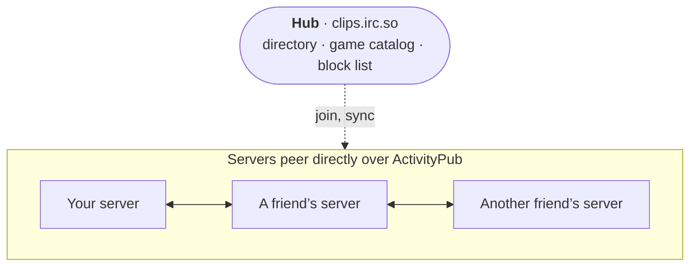

# Network

Each person runs their own server and hosts their own clips. Servers in a network see each other's public
clips under **Network**, on Home and in search, and people can like, comment on and subscribe to clips on any
of them.

- [How it works](#how-it-works)
- [Joining](#joining)
- [What every server controls](#what-every-server-controls)
- [Block lists](#block-lists)
- [Leaving](#leaving)
- [Running a hub](#running-a-hub)
- [Under the hood](#under-the-hood)
- [Testing several servers on one machine](#testing-several-servers-on-one-machine)

## How it works



- **Video files are never copied.** Viewers stream a clip from the server that hosts it. What travels between
  servers is the clip's details (title, thumbnail, game, counts) and the interactions.
- **Servers peer directly**, over ActivityPub (since OurTube 1.3): their instance actors follow each other,
  new clips arrive within seconds, and every round each server reads its peers' outboxes so nothing is missed.
- **Likes, comments and subscriptions** go to the server hosting the clip, so counts and comment threads are the
  same everywhere. That server answers each comment (shown, held for review, or refused). People from elsewhere
  appear as `name@their.host` and link back to their home server.
- **The hub is optional.** It is the easy way in, keeps the directory of servers, the network's
  [game catalog](Clip-Tools-and-Games.md#the-networks-game-catalog) and a block list the members follow, and
  it can moderate the whole network. If the hub goes offline, gets a legal notice or shuts down, the other
  servers keep seeing each other and keep liking and commenting.
- **Only public, ready clips with *Share with the network* ticked are ever listed.**
- **One person with accounts on several servers** can link them, so every server shows them as one person
  (*Also on*, one *Subscribe to all*, the uploader's mark on their comments). See
  [Linked accounts](Fediverse.md#linked-accounts).

## Joining

You need a Public URL with `https://` (Admin → Overview), reachable from the internet. Then **Admin → Network
→ Join network** and enter the hub's address (`https://clips.irc.so` by default) or the address of any server
already in the network; the rest are found from there. From the command line:

```bash
docker exec cliptube node server/cli.js network join https://clips.irc.so
```

If the hub requires approval, your server waits until the hub's admin approves it. Once in, other servers'
videos appear within a sync round, and the hub's games show up under Admin → Games.

Every video says where it lives: a tag on its thumbnail with the server's name and a colored dot (your own
server's videos too, once it is in a network). The same server has the same color on every server, since the
color comes from its address. Watch pages, channel pages and live cards show the server the same way.

## What every server controls

Every server stays in charge of itself. Under **Admin → Network** each one can:

- **peer with any server directly** (*Direct peers → Peer with it*), and see each peer's state both ways;
- **decide who may peer with it**: accept new servers (turning it off is a lockdown), ask first, HTTPS only, and
  a limit on peers;
- **block any server**, which hides its clips and refuses its likes, comments and subscriptions;
- **turn off accepting** comments, likes or subscriptions from other servers;
- keep a single public clip off the network by unticking **Share with the network** on it.

Failing peers are retried with a growing delay (from one minute, doubling, up to six hours).

## Block lists

A server can **publish its block list** and **follow other servers' lists**, applied automatically or after
your review. Members follow their hub's list automatically, so the hub's bans and network-wide hides reach them
even though they fetch clips from peers directly. A block that came from a list is lifted when its source lifts
it.

```bash
docker exec cliptube node server/cli.js network follow-blocklist https://clips.irc.so --mode review
```

## Leaving

- **Leave hub only** keeps your direct peers and stops using the hub.
- **Leave network** disconnects from everything. Your own clips are untouched.

```bash
docker exec cliptube node server/cli.js network leave --keep-peers    # hub only
docker exec cliptube node server/cli.js network leave                 # everything
```

## Running a hub

Turn it on in **Admin → Network → This instance is the hub** (or `network hub-enable <your-public-url>`).

| Setting | Default | What it does |
| --- | --- | --- |
| Accept new instances | on | Turn off to lock the network to its current members |
| Require my approval | off | New servers wait until the hub admin approves them |
| HTTPS only | on | Refuse servers not served over HTTPS (these three switches also decide who may peer with the hub) |
| Comments / likes / subscriptions between instances | on | Network-wide switches for each kind of interaction |
| Include this instance's videos | on | Share the hub's own public clips with the network |
| Max videos per instance | 5000 | Cap on how many clips one server can put in the index |
| Sync every | 10 min | How often the hub and members refresh (changes are also pushed within seconds) |
| Announcement | empty | A banner on the Network page of every server |

Per server, the hub admin can **approve**, **suspend** (drop it from the network for a while), **ban** (it
can't rejoin), **stop its likes and comments**, **hide its clips**, or **remove** it. Any single network clip
can be hidden too. Bans and hides go out through the hub's block list, so they reach every member.

The hub also keeps the network's game catalog, and with a SteamGridDB key its artwork (see
[Clip Tools and Games](Clip-Tools-and-Games.md#game-artwork-from-steamgriddb)).

## Under the hood

Protocol version 4, in short:

- `GET /.well-known/cliptube` describes a server: its admission switches and its instance actor.
- **Peering, clips and interactions are ActivityPub**, with a few OurTube extensions. The full design is in
  [docs/federation.md](https://github.com/JawshTheDark/ourtube/blob/main/docs/federation.md).
- **The instance layer is plain JSON over HTTPS:** `GET /api/network/known-peers` exchanges peer lists (signed
  with each server's Ed25519 key and checked at its own address), `GET /api/network/blocklist` publishes blocks,
  and members register with the hub (`POST /api/hub/join`, with a nonce callback to `/api/network/verify`) and
  read its directory, switches and game catalog (`/api/hub/directory`, `/api/hub/status`, `/api/hub/games`).
- Servers on OurTube 1.2 and earlier (protocol v3) are still understood during the transition: a newer server
  serves its v3 feed to them, reads theirs, and moves each one to ActivityPub once it has upgraded.

Check a server's view of the network at any time:

```bash
docker exec cliptube node server/cli.js network status
docker exec cliptube node server/cli.js network sync     # sync now and show the result
```

## Testing several servers on one machine

The network refuses to contact private addresses (localhost, LAN), so a test network on one machine needs
`--allow-private-federation` (or `FEDERATION_ALLOW_PRIVATE=1`) on every server:

```bash
DATA_DIR=./data-a PORT=3001 node server/index.js --allow-private-federation
DATA_DIR=./data-b PORT=3002 node server/index.js --allow-private-federation
```

Never use it on a public server. `npm run dev` turns it on for you.
