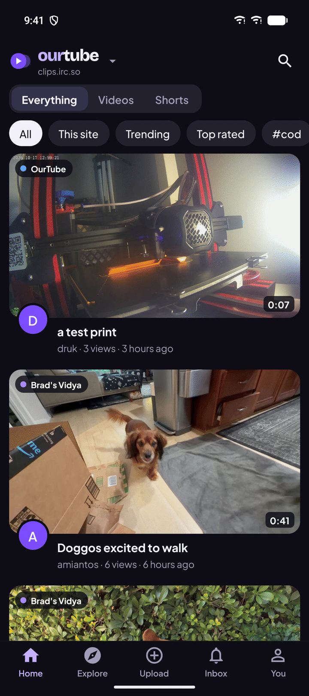
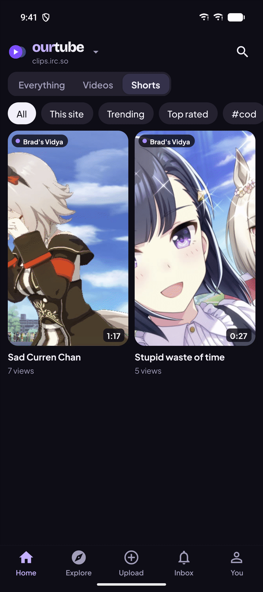
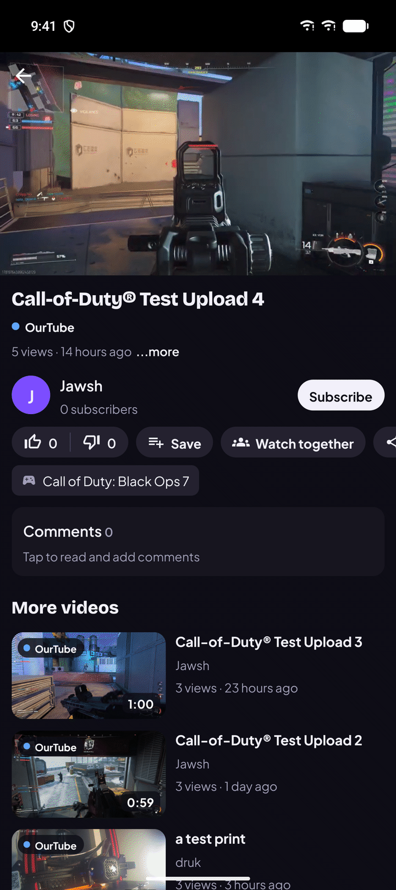
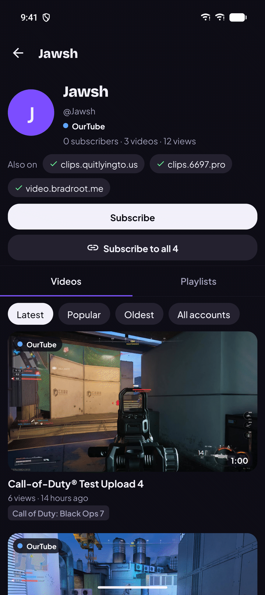

# OurTube for Android

A React Native app (Expo SDK 58, Expo Router) for OurTube servers (called ClipTube before 1.13): browse and watch
videos, Shorts and live streams, comment, like, subscribe, get notifications and upload from your phone. It talks
to the same API as the website and has the same look: the OurTube palette, Plus Jakarta Sans and Bricolage
Grotesque (bundled through expo-font), and the two-circle mark (`src/components/Logo.tsx`; the launcher icons come
from `python scripts/icons.py assets`).

<table>
  <tr>
    <td width="25%"></td>
    <td width="25%"></td>
    <td width="25%"></td>
    <td width="25%"></td>
  </tr>
</table>

## Install

Download the APK from the [GitHub releases](https://github.com/JawshTheDark/ourtube/releases) (tags named
`android-v…`) on the phone and open it. Newer releases install over older ones and keep your sign-ins.

Signing in needs **version 1.5 or newer** on the server, which added bearer-token sessions for the app.
Watching and browsing work on any version.

## What it does

| Area | Details |
| --- | --- |
| Home | Everything, Videos and Shorts, then All, This site, For you, Subscriptions, Trending, Top rated and popular tags, like the website; a Shorts shelf after the first eight videos and a 9:16 grid for Shorts |
| Watch | Native player (Media3) with fullscreen, picture-in-picture and resume; likes, subscribe, share, related videos |
| Network | Videos from other servers stream from their own server; likes, comments and subscriptions go through yours. In a network every card, watch page, channel and live card shows the server it lives on, with the website's color for it |
| Comments | Threads with replies, held and pending states, approve and delete for uploaders and moderators; times like 1:23 jump the video, Add time inserts the current one, and PeerTube videos show their whole thread (1.17+) |
| Shorts | A full-screen vertical viewer: one Short per page in a frame of its own shape, swipe for the next, tap to pause, mute, a progress line, like, dislike, comments in a sheet, share and the full page (1.17+) |
| Explore | Search with sorting, and the game catalog with SteamGridDB artwork; game and channel pages |
| Upload | Pick a video, set title, description, game, tags, visibility and clipping, watch progress and processing. On 1.10+ it goes up in 8 MB pieces that survive dropped connections and resume after the app is closed |
| You | Your videos (edit, publish drafts, delete), history, liked videos, subscriptions, sign out |
| Linked accounts | Link your accounts on other servers or Mastodon (1.6+); channels show Also on, Subscribe to all and an All accounts filter |
| Playlists | Save to Watch later or a playlist, play a list with shuffle, loop and autoplay, edit and reorder your own (1.7+) |
| Watch parties | Synced playback with chat, reactions, a shared queue and host controls, over the server's event stream (1.8+) |
| Live streams | Who's live on Home, live pages with the HLS stream, live chat (signed in or as a guest), reactions and chat moderation (1.9+) |
| Inbox | Notifications with an unread badge on the tab, checked every minute while the app is open |
| Tablets | Turns with the device; wide screens put the player beside the details (watch) or the chat (live, parties), and feeds show up to four cards across. Density (Comfortable, Compact, Dense) in App settings fits more videos with smaller cards |
| Servers | Pick your main server on first launch (the app opens on it; change it under You → App settings), keep more servers with a sign-in for each, and switch between them |
| Links | `https://<server>/watch/…`, `/shorts/…`, `/c/…` and `/n/…` links for the three known servers can open in the app |

Not in the app yet (use the website): the timeline editor, thumbnails, captions, analytics, admin and
moderation pages, push notifications.

## How sign-in works

The app logs in with `POST /api/auth/login` and `"return_token": true`. The server answers with a session
token instead of setting a cookie, and the app sends it as `Authorization: Bearer <token>`. Tokens are kept per
server in the Android keystore (expo-secure-store). The app only sends a token to the server it belongs to,
including to the video player, so private videos play and no other server sees it. Signing out ends that
session on the server.

## Develop

```bash
cd mobile
npm install
npx expo run:android      # debug build on a connected phone or a running emulator
npm run typecheck
```

A debug build loads JavaScript from Metro on your computer, so edits show up at once. Expo Go can't run this
app because it uses its own native configuration (video player, link handling, cleartext for LAN servers).

To try it against a local server, run the server on your computer and add `http://10.0.2.2:3000` (the emulator's
address for your computer) or your computer's LAN address under You → Servers.

Routes live in `src/app` (file-based, like the website's paths: `watch/[id]`, `n/[peer]/[remote]`,
`c/[username]`, `g/[id]`), shared code in `src/lib` and `src/components`. The `android/` folder is generated by
`expo prebuild` and isn't committed; native settings go in `app.json` and `plugins/`.

## Build a release APK

```bash
npm run build:apk
```

This regenerates `android/`, builds a release APK for arm64-v8a, armeabi-v7a and x86_64, and copies it to
`dist/ourtube-<version>.apk`. It needs the Android SDK (`ANDROID_HOME`, or Android Studio's default
location) and JDK 17 or newer (`JAVA_HOME`, or the JDK that ships with Android Studio).

On Windows the native parts would pass the 260-character path limit from a folder this deep, so the script
builds in a mirror at `C:\Users\<name>\.ctb` (or `CLIPTUBE_BUILD_DIR`), kept in sync with robocopy. The
first build there takes about six minutes; delete the folder to reclaim the space.

The APK is signed with the upload key when these are set, in the environment or in
`~/.cliptube/android-release.properties`:

| Variable | Meaning |
| --- | --- |
| `CLIPTUBE_KEYSTORE` | Path to the keystore (`.jks`) |
| `CLIPTUBE_KEYSTORE_PASSWORD` | Its password (also used for the key unless `CLIPTUBE_KEY_PASSWORD` is set) |
| `CLIPTUBE_KEY_ALIAS` | Key alias, `cliptube` by default |

Without them the APK is signed with the debug key. It installs, but Android won't update an APK that was
signed with a different key, so keep the upload key safe: losing it means everyone reinstalls.

## Release

1. Bump `expo.version` and `expo.android.versionCode` in `app.json` (the version code must go up every
   release) and update `RELEASE_NOTES.md`.
2. Commit, then tag and push: `git tag android-v1.0.1 && git push origin android-v1.0.1`.
3. The **Android app** workflow builds the signed APK and attaches it to that tag's GitHub release, creating
   the release if needed. It reads the key from two repository secrets, which you add once:

   ```bash
   base64 -w0 ~/.cliptube/android-release.jks | gh secret set ANDROID_KEYSTORE_BASE64
   gh secret set ANDROID_KEYSTORE_PASSWORD
   ```

   The second command asks for the password, which is in `~/.cliptube/android-release.properties`.

Without the secrets, a tag build only leaves a warning. Build the APK yourself and publish it instead:

```bash
npm run build:apk
gh release create android-v1.0.1 dist/ourtube-1.0.1.apk --title "OurTube for Android 1.0.1" --notes-file RELEASE_NOTES.md
```

Running the workflow by hand from the Actions tab builds an APK as a workflow artifact without a release.
